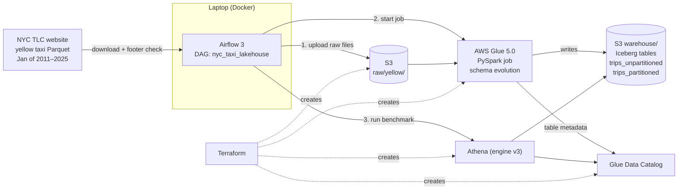

# NYC taxi lakehouse on AWS (S3 + Glue PySpark + Apache Iceberg + Athena)

## The problem

NYC's taxi trip files don't keep the same columns from year to year. In the 15 January
files from 2011 to 2025, `passenger_count` and `RatecodeID` change from `int64` to `double`
(2019) and back to `int64` (2024); the location and vendor IDs shrink from `int64` to `int32`
(2024); `airport_fee` becomes `Airport_fee` (2024); fee columns that didn't exist yet are
stored as empty columns with different types in different years; and `cbd_congestion_fee`
appears for the first time in 2025. A simple "read all files and load them" job either fails
or quietly gets columns wrong. This project loads all 15 files into **one** Apache Iceberg
table without losing data, then measures how much partitioning cuts the data (and money)
each Athena query scans. The full column-by-year table is in
[`results/raw_schema_diff.md`](results/raw_schema_diff.md).

## Architecture



All AWS resources (S3 bucket, Glue database and job, IAM role, Athena workgroup,
budget alert) are in Terraform under `infra/`.

## How it handles column changes

The Glue job (`glue_jobs/load_trips.py`) reads **one file at a time**, cleans it,
and compares its columns with the table. `glue_jobs/schema_utils.py` decides
what to do with each column, using Iceberg schema evolution:

| What the new file has | What the job does |
|---|---|
| A new column | `ALTER TABLE ... ADD COLUMN` (old rows read `NULL`) |
| A missing column | writes `NULL` for it |
| A smaller number type than the table (int vs bigint) | casts it up, no data lost |
| `double` where the table has `bigint` (`passenger_count`, 2019) | checks every value is a whole number, then converts; stops if any value has a fraction |
| A bigger number type than the table (bigint vs int) | promotes the table column (`ALTER COLUMN ... TYPE bigint`) |
| A column that is empty in every row | ignores its type, so it can't block real values later |
| A different letter case (`Airport_fee`) | names are lower-cased, so it lands in `airport_fee` |
| Times stored in nanoseconds | converted to microsecond timestamps |
| Anything unsafe (text vs number) | stops with a clear error. It never guesses. |

Every change is written to a load report, and row counts are checked against
each raw file's Parquet footer. Re-running the job skips files already loaded.

The same rows go into two Iceberg tables so they can be compared:

* `trips_unpartitioned` – no partitions
* `trips_partitioned` – hidden partitioning by `months(tpep_pickup_datetime)`

## Result

> **Pending.** These numbers will be filled in from the first real run
> (`results/RESULTS.md` and `results/LOAD.md`). Nothing here is estimated.

| query | not partitioned | partitioned | less data scanned |
|---|---:|---:|---:|
| q1: one month (Jan 2019) | – | – | – |
| q2: Jan 2023 – Jan 2025 | – | – | – |
| q3: new 2025 column | – | – | – |
| q4: no time filter (control) | – | – | – |

Rows loaded: –. Total AWS cost for the project: –.

## How to run it

You need: an AWS account, the AWS CLI with a profile called `nyc-taxi`,
Terraform ≥ 1.6, Docker, Python 3.11+. Full step-by-step notes (including
creating the AWS user) are in [RUNBOOK.md](RUNBOOK.md).

```bash
make test          # unit tests, no AWS needed
make billing       # 1. budget alert first (emails you at $1 and $5)
make infra         # 2. S3, Glue, Athena, IAM
make env           # 3. write .env for Airflow from Terraform outputs
make airflow-up    # 4. Airflow at http://localhost:8080
make run           # 5. trigger the DAG: upload -> Glue load -> report -> Athena benchmark
make destroy       # 6. delete everything in AWS
```

Results are written to `results/`.

**Cost guards:** budget alert, Glue job timeout of 45 minutes with 2 workers and
no retries, an Athena per-query scan limit of 10 GB, and lifecycle rules that
delete Athena results after 7 days.

## What I'd do next

- Load every month, not just January, and add green taxi and for-hire-vehicle trips.
- Run Iceberg maintenance (`rewrite_data_files`, `expire_snapshots`) and measure the effect of compaction.
- Add data-quality checks (e.g. pickup dates far outside the file's month) with a quarantine table.
- Run the DAG on Amazon MWAA or trigger it when TLC publishes a new month.

## Data

[NYC Taxi & Limousine Commission trip record data](https://www.nyc.gov/site/tlc/about/tlc-trip-record-data.page).
The TLC says it did not create the trip data and makes no claims about its accuracy.
